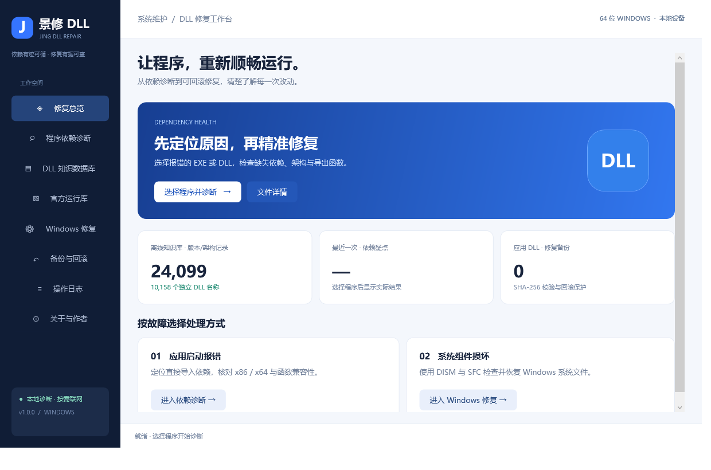
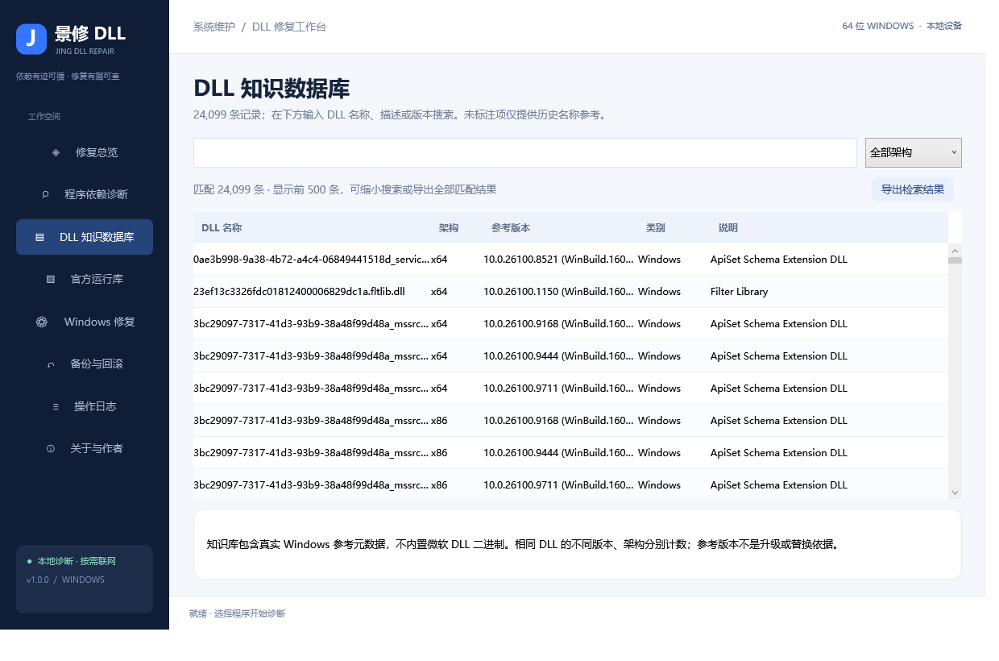
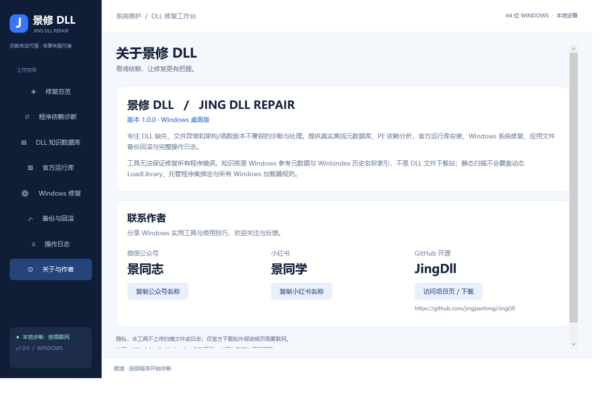
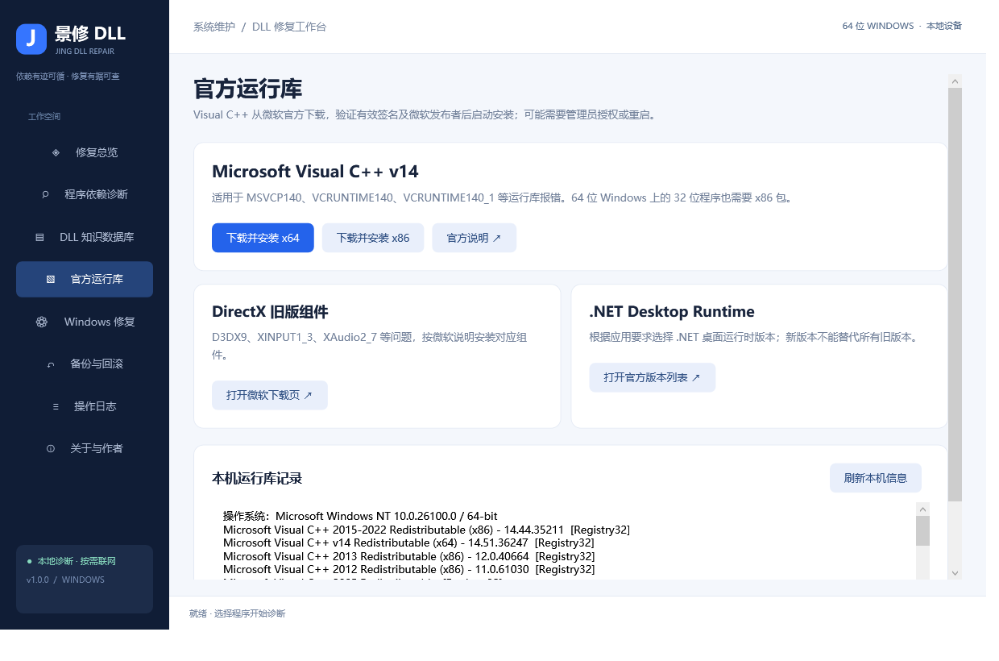
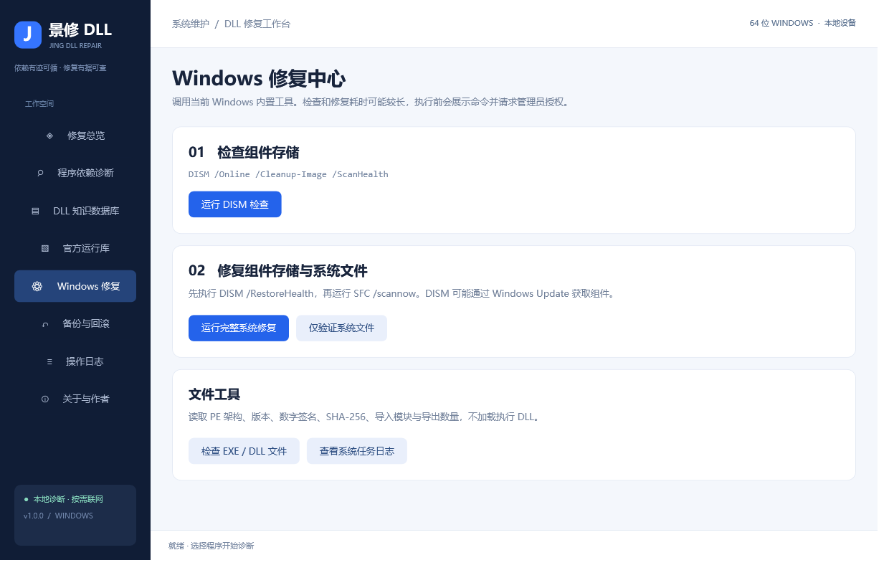

# 景修 DLL（JingDll）

> 看清依赖，让修复更有把握。

Windows 程序依赖诊断与修复工具。当软件因缺少 DLL、文件异常或架构/函数版本不兼容而无法启动时，用它看清依赖关系，再用官方渠道稳妥修复。

- **平台**：Windows 10 / 11（x86、x64），依赖系统 .NET Framework 4.8
- **许可**：[GPL-3.0](LICENSE.txt)
- **开源地址**：https://github.com/jingpanlong/JingDll

## 界面截图

| 修复总览 | DLL 知识数据库 |
| :-: | :-: |
|  |  |

| 关于软件与作者 | 官方运行库 | Windows 修复中心 |
| :-: | :-: | :-: |
|  |  |  |

## 下载

前往 [Releases 页面](https://github.com/jingpanlong/JingDll/releases) 获取最新版本：

| 文件 | 说明 |
| --- | --- |
| `JingDll.exe` | 单文件便携版，直接双击启动，无需安装 |
| `JingDll-Setup.exe` | 安装版，包含开始菜单入口、可选桌面快捷方式及系统卸载登记 |

- 直达下载：[JingDll.exe（单文件版）](https://github.com/jingpanlong/JingDll/releases/latest/download/JingDll.exe) · [JingDll-Setup.exe（安装版）](https://github.com/jingpanlong/JingDll/releases/latest/download/JingDll-Setup.exe)
- 本构建未进行商业代码签名，Windows 可能显示未知发布者提示。
- 软件「关于与作者」页内也提供了 GitHub 项目页入口，可一键访问下载。

## 主要功能

- **修复总览**：实际数据库条目数、独立名称数、最近诊断疑点、已部署修复记录数。
- **程序依赖诊断**：读取 EXE/DLL 的 PE32 / PE32+，解析直接导入与基于 RVA 的延迟导入，区分 x86、x64、ARM64、CLR AnyCPU；检查候选文件、架构、必需导出名称及序号。
- **API Set 合约说明**：不将没有同名物理文件的 API Set 合约简单判为缺失。
- **DLL 知识数据库**：24,099 条离线记录、10,158 个独立 DLL 名称；支持名称/描述/版本检索、架构筛选，可导出全部匹配记录 TSV。
- **官方运行库**：从微软官方链接按需下载 x86 / x64 Visual C++ v14 安装包；验证有效 Authenticode 签名和 Microsoft Corporation 发布者后启动安装。
- **DirectX / .NET**：打开对应微软官方组件下载与版本选择页，由用户选择所需版本。
- **Windows 修复**：UAC 提权后执行 DISM ScanHealth、SFC verifyonly、DISM RestoreHealth 后接 SFC scannow；独立实时输出窗口、原始日志和退出码。
- **可信本地文件修复**：仅向用户应用目录部署直接导入的同名 DLL；验证架构、导出函数；禁止 Windows、Program Files、工具数据目录及重解析点；禁止 KnownDLLs / API Set 替换。
- **备份与回滚**：替换前保存原始文件和 SHA-256；临时文件与原子替换；外部修改后拒绝覆盖回滚。
- **文件详情**：PE 类型、版本、产品、公司、Authenticode 信任验证、SHA-256、导入模块、导出数量和文本导出。
- **操作日志**：查看与导出；诊断 CSV 报告。

## 使用方法

简要流程（详见 [docs/使用说明.txt](docs/使用说明.txt)）：

1. 在「程序依赖诊断」中选择报错程序的 EXE，点击「开始诊断」。
2. 选中诊断结果查看候选路径、架构、缺少导出函数及建议。
3. MSVCP140 / VCRUNTIME140 等问题：进入「官方运行库」，按程序架构安装 x86 或 x64 包。
4. DirectX 或 .NET 问题：使用对应官方页面选择应用要求的组件版本。
5. Windows 系统组件损坏：进入「Windows 修复」，先检查或执行完整系统修复。
6. 应用私有 DLL 缺失：关闭目标程序，从原软件的可信安装包提供同名 DLL，点击「从可信文件修复选中 DLL」。
7. 如需撤销：在「备份与回滚」选中记录回滚。

## 数据库说明

本构建 `catalog.tsv` 共 **24,099 条记录、10,158 个独立 DLL 名称**。

1. `catalog-reference.tsv`：构建机 Windows System32、SysWOW64、Microsoft.NET、WinSxS 中实际 PE 文件的名称、架构、FileVersionInfo 与描述。无微软 DLL 二进制。可使用 `CatalogBuilder.cs` 从自己的 Windows 环境重新生成。
2. `winbindex-dll-names.txt`：[Winbindex](https://github.com/m417z/winbindex) 公开 `filenames.json` 中 9,652 个 DLL 名称快照（2026-10-24 获取）。版本和架构明确标为「未标注」。
3. `Merge-Catalog.ps1`：合并上述来源；相同名称/架构/版本不重复计数。

知识库是 Windows 参考元数据与 Winbindex 历史名称索引，**不是 DLL 文件下载站**：不含 7000 个可任意分发的 DLL 文件，没有后台随机下载 DLL 的行为。实际修复通过 Windows 官方工具、官方运行库，或用户提供的可信软件原始 DLL 完成。

## 自己构建

无需 .NET SDK 或 Visual Studio，使用 Windows 自带的 .NET Framework C# 编译器：

```powershell
powershell -NoProfile -ExecutionPolicy Bypass -File .\build.ps1
```

产物：`dist\JingDll.exe` 和 `dist\JingDll-Setup.exe`。若编译器组件被裁剪，需安装 .NET Framework 开发工具。`JingDll.csproj` 也可在具有 .NET Framework 4.8 开发工具的 Visual Studio 中打开。

## 验证

```powershell
Start-Process .\dist\JingDll.exe -ArgumentList '--self-test', 'C:\Temp\JingDllTests' -Wait
Start-Process .\dist\JingDll.exe -ArgumentList '--ui-test', 'C:\Temp\JingDllUiTests' -Wait
Start-Process .\dist\JingDll-Setup.exe -ArgumentList '--test-install', 'C:\Temp\JingDllInstallTest' -Wait
Start-Process .\dist\JingDll-Setup.exe -ArgumentList '--test-uninstall', 'C:\Temp\JingDllInstallTest' -Wait
```

核心 27 项检查、界面 12 项检查、安装/卸载文件流程均通过，详见 [docs/测试报告.txt](docs/测试报告.txt)。

## 修复边界

这是一款可运行的诊断与修复工具，不能保证修复所有程序错误：

- 静态扫描覆盖直接导入和延迟导入，不覆盖递归完整依赖图、动态 LoadLibrary、P/Invoke、全部托管程序集绑定、完整的 SxS / KnownDLLs / 已加载模块决策或应用自定义 DLL 搜索目录。
- 候选文件不代表操作系统最终实际加载的文件；导出存在也不保证运行语义和 ABI 完全兼容，应使用原软件相同版本的文件。
- Windows KnownDLLs 与 API Set 不允许通过应用目录替换；Windows、Program Files、工具数据目录及符号链接/目录联接中的文件不支持私有 DLL 替换。
- AnyCPU 按 CLR 标志和当前系统推断运行架构；ARM64 仅能读取文件架构元数据，未在 ARM64 Windows 验证。

## 隐私与数据

数据保存在 `%LOCALAPPDATA%\JingDll`，包含日志、修复记录、原始备份和下载的官方安装包。**不会自动上传扫描文件和日志**；官方组件下载、外部说明页及 Windows 修复可能联网。导出的日志与报告可能含本机路径，分享前请检查。卸载程序会保留个人备份及日志。

## 许可

本项目按 [GPL-3.0](LICENSE.txt) 发布，包含 Winbindex 名称索引，保留其 GPL-3.0 许可和来源。Microsoft、Windows、Visual C++、DirectX 和 .NET 属于其各自权利人，本程序不包含或重新许可微软 DLL 二进制。

## 联系作者

- 微信公众号：**景同志** · 小红书：**景同学**
- GitHub Issues：https://github.com/jingpanlong/JingDll/issues
